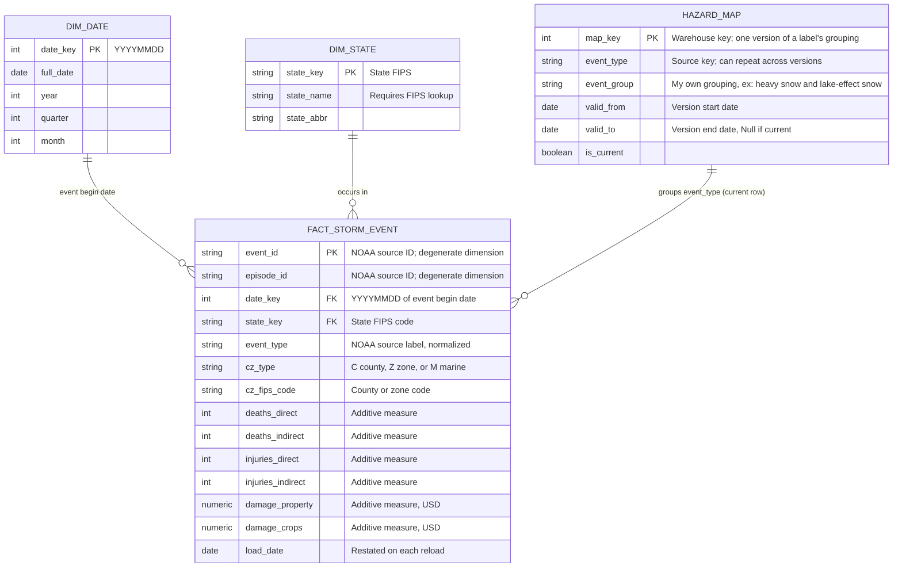

#### 1. Establish the question and check the source

Audience and Need: This project is targeted for hazard mitigation planners at state emergency management agencies who develop and maintain mitigations plans by deciding which hazards to prioritize for mitigation funding. A data product that summarizes event frequency, injuries, and damage done by storms over a recent 10-year window can help to accurately prioritize hazards which in turn might be used to target grant applications and apply funding towards the most frequent/deadly types of storms occuring in that state.

Primary Question: Which hazard types account for the largest share of reported deaths and injuries, and the largest share of property and crop damage, in each state over the last 10 years?

P0 Changes: I am dropping Q3, 'How does a state’s reported loss (per-capita) for a given hazard compare with a set of peer states?', per feedback, and focusing on Q1 as the primary question (above).

Source objects project and dataset: bigquery-public-data | noaa_historic_severe_storms

Candidate tables and location: storms_2016, storms_2017, storms_2018, storms_2019, storms_2020, storms_2021, storms_2022, storms_2023, storms_2024, storms_2025 | US

Source Row Meaning: Each source row is a location for one storm event. Events with a single location have one row, and events with several points repeat across several rows. The event’s details, deaths, injuries, and damage are copied into each of its rows, so they describe the whole event, not that specific point.

Source Size and Date Coverage:
| Year | Rows | First event | Last event | Size (MB) |
|:-----|-----:|:------------|:-----------|----------:|
| 2016 | 77,291 | 2016-01-01 00:00 | 2016-12-31 23:15 | 16.4 |
| 2017 | 81,655 | 2017-01-01 00:00 | 2017-12-31 23:23 | 17.6 |
| 2018 | 97,931 | 2018-01-01 00:00 | 2018-12-31 23:30 | 20.8 |
| 2019 | 102,613 | 2019-01-01 00:00 | 2019-12-31 23:50 | 21.8 |
| 2020 | 85,232 | 2020-01-01 00:00 | 2020-12-31 22:30 | 18.1 |
| 2021 | 83,083 | 2021-01-01 00:00 | 2021-12-31 23:56 | 16.9 |
| 2022 | 83,338 | 2022-01-01 00:00 | 2022-12-31 23:30 | 15.9 |
| 2023 | 91,312 | 2023-01-01 00:00 | 2023-12-31 05:35 | 17.4 |
| 2024 | 85,896 | 2024-01-01 00:00 | 2024-12-31 23:30 | 16.5 |
| 2025 | 93,203 | 2025-01-01 00:00 | 2025-12-31 23:40 | 18.4 |
| **All years** | **881,554** | **2016-01-01 00:00** | **2025-12-31 23:40** | **179.8** |

Candidate Identifiers: `event_id` combined with `location_index` uniquely identifies each source row. `event_id'  will be the key once the data is deduplicated to one row per event. The output is grouped by `state_key` and `event_group` from the current hazard map row.

Data Issue or Restriction: Deaths, injuries, and damage are repeated for events with multiple location rows. Summing these facts from the source table would be an artificial inflation. Deduplicating to one row per `event_id` before aggregating fixes this. Also, `state` is ambiguous ("Ar" could be Arizona or Arkansas), so `state_fips_code` is used as the state key.

Focused Source Profile:
| Year | Source rows | Fact rows | Rows removed |
|:-----|------------:|----------:|-------------:|
| 2016 | 77,291 | 56,005 | 21,286 |
| 2017 | 81,655 | 57,041 | 24,614 |
| 2018 | 97,931 | 62,699 | 35,232 |
| 2019 | 102,613 | 67,864 | 34,749 |
| 2020 | 85,232 | 61,281 | 23,951 |
| 2021 | 83,083 | 61,389 | 21,694 |
| 2022 | 83,338 | 69,887 | 13,451 |
| 2023 | 91,312 | 75,593 | 15,719 |
| 2024 | 85,896 | 69,801 | 16,095 |
| 2025 | 93,203 | 72,360 | 20,843 |
| **All years** | **881,554** | **653,920** | **227,634** |

Checks
| Check | Description | Expected | Observed | Conclusion |
|:------|:------------|---------:|---------:|:-----------|
| 1 | Source rows (2016–2025) | 881,554 | 881,554 | Matches the P0 row count. |
| 2 | Source rows missing `event_id` | 0 | 0 | Every row has the proposed fact identifier. |
| 3 | Source rows missing `location_index` | 0 | 320,247 | Unexpected. Check 3a was added to explain it. |
| 3a | Events mixing missing and present `location_index` | 0 | 0 | Every row with a missing `location_index` is the only row for its event, so a null means a single-location event, not a data defect. |
| 4 | Source rows missing `state_fips_code` | 0 | 0 | The state key is fully populated. |
| 5 | Source rows missing `event_type` | 0 | 0 | The hazard label is fully populated. |
| 6 | Repeated (`event_id`, `location_index`) groups | 0 | 0 | The source grain is one row per event location. |
| 7 | Repeated `event_id` groups in source | > 0 | 83,379 | 83,379 events span multiple location rows, so a selection rule is needed before summing measures. |
| 8 | Events whose measures or key attributes vary across location rows | 0 | 0 | The selection rule produces one row per `event_id`. |

Conclusion:

The fact grain is one row per storm event, identified by `event_id`; one hazard type in one county, forecast zone, or marine zone within one state, with its deaths, injuries, and damage recorded once.

The source tables are stored with one row per location point, so the fact is built with a selection rule that keeps one row per `event_id`. The fact grain is confirmed by Checks 7 and 8, showing the 83,379 multi row events contain the same numbers on each of the rows. Since casualties and damage are recorded to the hazard and county where they happened, summing fact rows by `state_key` and `event_group` will result in each state's impact by hazard type while avoiding duplicate counting across counties, states, or hazard types.

#### 2. Define the model and predict a history consequence

Business Process: Storm event reporting from the NOAA departmenr where significant weather events are recorded along with the number of deaths, injuries, and damage that the event caused.

Fact-table Type: Transaction fact table. Each row is one recorded event, and every measure is additive across hazard, place, and time.

Fact-table Grain: One row represents one NOAA-reported storm event; a single event type in a single forecast zone, starting at a single time, identified by NOAA's event_id.

Consequential Modelling Choice: By choosing event-grain, and not location-point grain, the storm event damage, injury, and death data can safely be added. The tradeoff is that location information is lost - if this information were to be used in GIS, tornado paths could not be correctly mapped. This decision is acceptable for the selected question that is working at a state-level scale.



Tracing Modelling Question:

The primary question I am analyzing asks which hazard types account for the most deaths, injuries, and damage (property and crop) in each state from 2016 to 2025. The `FACT_STORM_EVENT` helps to answer this as each row is one storm event with the impacts counted only once so the measures related to deaths, injuries, and damage can be summed. The fact table is joined to `DIM_DATE` via the event start date, where a filter is applied for 2016 through 2025. It is also joined to `DIM_STATE` via the FIPS code, and joined to `DIM_HAZARD` which supplies information about the event through the `event_type` field. `event_group` is a potential method to group the events together for easier product consumption by reducing the amount of similar hazards to those that are related - this is joined to `HAZARD_MAP` on the `event_type`. In summary, each measure is summed by state and hazard type which will then be ranked to determine which is responsible for the largest quantity of deaths, injuries, and damage.

History Decision:

`event_type` is the attribute that is most likely to change (or be reclassified); NOAA may change spelling, naming, split a hazard into two type, or group hazards together overtime as climate change shifts standard hazard behaviors and classifications. Instead of overwriting labels, each NOAA label is kept as recorded on the fact and a `hazard_map` lookup table assigns each label to an event group, which implements Type 2 history. The `event_type` is the source key, `map_key` is the warehouse key that identifies a verion of the label's grouping. If a label is changed, such as `lake-effect snow` becoming `lake effect snow`, a new row is added that maps the new label to the same group of `Snow`. If a label moves to a different grouping, the old row is closed via an end date and a new row is added to the new group with a start date. As far as impacts on the primary analytical question, a rename (keeping the label in the same group) will not have an effect. If a label is regrouped, such as `heat-related` moving to the `Heat` group, the deaths, injuries, and damage for all 10 years would join that group and potentially move the group ranking higher. The results will be reported using the current mapping

The small behavior I can test by P3 confirming each event type label matches exactly one hazard mapping grouping `is_current` row (ex: `lake-effect snow' should not be mapped to `Snow` and `Winter Hazards`).

#### 3. Plan the build and its checks

Raw, Curated, and Serving objects:

| Layer | Object | What it does |
|:------|:-------|:-------------|
| Raw | `raw_storm_events` | Reads `storms_2016` to `storms_2025` source tables through a `storms_*` wildcard with no changes. Keeps the source grain. |
| Curated | `dim_date` | One row per calendar date, 2016 to 2025. |
| Curated | `dim_state` | One row per state FIPS code, with name and abbreviation coming from the Census lookup. |
| Curated | `hazard_map` | One row for a version of a label's grouping with one current row per label. |
| Curated | `fact_storm_event` | Appliy the selection rule and adds `date_key`, `state_key`, and `hazard_key`, and keeps the casualty and damage measures. |
| Serving | `srv_state_hazard_shares` | One row per state and `event_group`, with summed deaths, injuries, property damage, and crop damage, and its rank within the state. |
| Serving | `srv_state_top_hazards` | The top hazard for each state and measure for the hazard planner summary. |

Preliminary Run Order:

1. Create raw_storm_events view, check it returns 881,554 rows.
2. Build dim_date, dim_state, and hazard_map and confirm unique keys and every source label maps to a hazard exactly once.
3. Build fact_storm_event. Confirm it has 653,920 rows which matches distinct source events, no repeated event_id, and no keys missing from their dimensions.
4. Build srv_state_hazard_shares. Check that shares add up to 100% within each state and measure.
5. Build srv_state_top_hazards. Check there’s one row per state and measure - review ties if needed.

Trace of One Measure: `deaths_direct`

| Stage | Object | Form | Transformation |
|:------|:-------|:------------------------|:---------------|
| Source | `storms_*` | Deaths for one event. Repeated for each of the location rows | None |
| Raw | `raw_storm_events` | Same as source. | None |
| Curated | `fact_storm_event` | Deaths counted once per event | Selection rule keeps one row per `event_id`.The event is linked to its state via FIPS, its hazard via the normalized label, and the date through the begin date |
| Serving | `srv_state_hazard_shares` | Total deaths per state and hazard group | Filtered to 2016 to 2025, summed up by `state_key` and `event_group`, and divided by the state's total deaths. A rank is applied. |

Project-Specific Risks:

1. An event is lost or duplicated when the fact joins to the dimensions.
    - Planned Check: count repeated event_ids, count fact rows where state_key, event_type, or date_key has no match in its dimension after creating the fact_storm_event table.
    - Expected results: 0 repeated IDs and 0 unmatched keys for each dimension
    - Where it will run: Within the curated layer after step 3 of the prelim run order.
  
2. The summed values (or shares of each value) are not the state's real total.
    - Planned check: for each state and measure, confirm that the hazard shares up to 100% and summing of deaths, injuries, etc. equal the fact totals for the 10 year period.
    - Expected results: Shares should equal 100%, and serving totals equal fact totals for each measure.
    - Where it will run: Within the serving layer after 4 of the prelim run order.
  
Sensitivity of Traced Field: `deaths_direct` is public information and low-risk. The dataset does not contain names, personal details, or age, therefore no exclusion or restricted access is needed. The intended users are state hazard mitigation planners, NOAA owns the data and I am acting as the data steward for the curated and serving tables. `deaths_direct` will appear in the audience output as intended.

Largest Remaining Limitation:

`event_group`s are my own interpretation as NOAA does not provide any official groupings. These decisions may change which hazard ranks first in a state and will need to be documented.

First Concrete P2 Build Step:

Create a view of the raw data in my project and confirm the row count of 881,554.
```
CREATE OR REPLACE VIEW `peppy-castle-507918-u6.storm_risk_raw.raw_storm_events` AS
SELECT *, _TABLE_SUFFIX AS source_year
FROM `bigquery-public-data.noaa_historic_severe_storms.storms_*`
WHERE _TABLE_SUFFIX BETWEEN '2016' AND '2025';

SELECT COUNT(*) AS raw_rows
FROM `peppy-castle-507918-u6.storm_risk_raw.raw_storm_events`;
```

#### 4. Diagnose and revise the plan

During the in class review, the concern of too many different storm types was brought up as many of the unique values sound similar. This is where the idea of storm grouping started, which should work well for testing out how to manage history. Additionally, we discussed strategies for discovering the source grain, as at the time it was unclear as to why events had multiple rows.

AI Disclaimer: AI was used to write the SQL checks for the source profile, manage the syntax for GitHub formatting, and conversion/enhancement of the ER Diagram from what I described to a mermaid code block. GitHub syntax was verified by committing, reviewing the appearance, and adjusting as necessary. SQL checks were emulated in Excel as the dataset(s) are not too large to confirm quantities, null values, and unique values. AI was also used to help discover the repeat source rows by uploading the source table attribute metadata to design checks which ultimately led to the selection rule.
