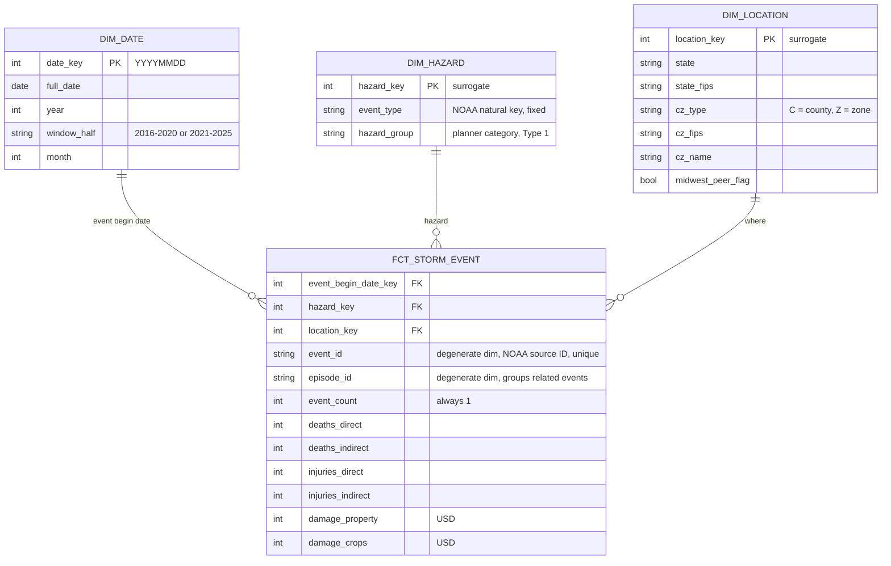

#### 1. Establish the question and check the source

Audience and Need: This project is targeted for hazard mitigation planners at state emergency management agencies who develop and maintain mitigations plans by deciding which hazards to prioritize for mitigation funding. A data product that summarizes event frequency, injuries, and damage done by storms over a recent 10-year window can help to accurately prioritize hazards which in turn might be used to target grant applications and apply funding towards the most frequent/deadly types of storms occuring in that state.

Primary Question: Which hazard types account for the largest share of reported deaths and injuries, and the largest share of property and crop damage, in each state over the last 10 years?

Source objects project and dataset: bigquery-public-data | noaa_historic_severe_storms

Candidate tables and location: storms_2016, storms_2017, storms_2018, storms_2019, storms_2020, storms_2021, storms_2022, storms_2023, storms_2024, storms_2025 | US

Row Count:
| Table | Row Count |
|---|---:|
| storms_2016 | 77,291 |
| storms_2017 | 81,655 |
| storms_2018 | 97,931 |
| storms_2019 | 102,613 |
| storms_2020 | 85,232 |
| storms_2021 | 83,083 |
| storms_2022 | 83,338 |
| storms_2023 | 91,312 |
| storms_2024 | 85,896 |
| storms_2025 | 93,203 |

#### 2. Define the model and predict a history consequence

Business Process: NOAA's recording of severe storm events and their reported human and economic impacts.

Fact-table Type: Transaction fact table. Each row is one recorded event, and every measure is additive across hazard, place, and time.

Grain: One row represents one NOAA-reported storm event; a single event type in a single forecast zone, starting at a single time, identified by NOAA's event_id.

#### 3. Plan the build and its checks

#### 4. Diagnose and revise the plan
