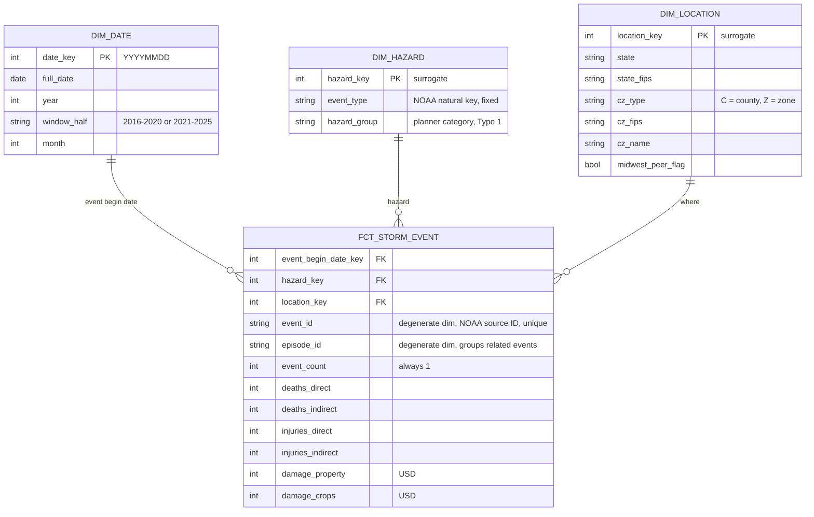

#### 1. Establish the question and check the source

Audience and Need: This project is targeted for hazard mitigation planners at state emergency management agencies who develop and maintain mitigations plans by deciding which hazards to prioritize for mitigation funding. A data product that summarizes event frequency, injuries, and damage done by storms over a recent 10-year window can help to accurately prioritize hazards which in turn might be used to target grant applications and apply funding towards the most frequent/deadly types of storms occuring in that state.

Primary Question: Which hazard types account for the largest share of reported deaths and injuries, and the largest share of property and crop damage, in each state over the last 10 years?

P0 Changes: I am dropping Q3, 'How does a state’s reported loss (per-capita) for a given hazard compare with a set of peer states?', per feedback, and focusing on Q1 (above).

Source objects project and dataset: bigquery-public-data | noaa_historic_severe_storms

Candidate tables and location: storms_2016, storms_2017, storms_2018, storms_2019, storms_2020, storms_2021, storms_2022, storms_2023, storms_2024, storms_2025 | US

Source Row Meaning: Each source row is a location for one storm event. Events with a single location have one row, and events with several points repeat across several rows. The event’s details, deaths, injuries, and damage are copied into each of its rows, so they describe the whole event, not that specific point.

Source Size and Date Coverage:
| Year | Rows | First event | Last event | Size (MB) |
|:-----|-----:|:------------|:-----------|----------:|
| 2016 | 77,291 | 2016-01-01 00:00 | 2016-12-31 23:15 | 16.4 |
| 2017 | 81,655 | 2017-01-01 00:00 | 2017-12-31 23:23 | 17.6 |
| 2018 | 97,931 | 2018-01-01 00:00 | 2018-12-31 23:30 | 20.8 |
| 2019 | 102,613 | 2019-01-01 00:00 | 2019-12-31 23:50 | 21.8 |
| 2020 | 85,232 | 2020-01-01 00:00 | 2020-12-31 22:30 | 18.1 |
| 2021 | 83,083 | 2021-01-01 00:00 | 2021-12-31 23:56 | 16.9 |
| 2022 | 83,338 | 2022-01-01 00:00 | 2022-12-31 23:30 | 15.9 |
| 2023 | 91,312 | 2023-01-01 00:00 | 2023-12-31 05:35 | 17.4 |
| 2024 | 85,896 | 2024-01-01 00:00 | 2024-12-31 23:30 | 16.5 |
| 2025 | 93,203 | 2025-01-01 00:00 | 2025-12-31 23:40 | 18.4 |
| **All years** | **881,554** | **2016-01-01 00:00** | **2025-12-31 23:40** | **179.8** |

Candidate Identifiers: `event_id` combined with `location_index` uniquely identifies each source row. `event_id'  will be the key once the data is deduplicated to one row per event. `state_fips_code` combined with `event_type` will be used as identifiers for the analysis output.

Data Issue or Restriction: Deaths, injuries, and damage are repeated for events with multiple location rows. Summing these facts from the source table would be an artificial inflation. Deduplicating to one row per `event_id` before aggregating fixes this. Also, `state` is ambiguous ("Ar" could be Arizona or Arkansas), so `state_fips_code` is used as the state key.

Focused Source Profile:
| Year | Source rows | Fact rows | Rows removed |
|:-----|------------:|----------:|-------------:|
| 2016 | 77,291 | 56,005 | 21,286 |
| 2017 | 81,655 | 57,041 | 24,614 |
| 2018 | 97,931 | 62,699 | 35,232 |
| 2019 | 102,613 | 67,864 | 34,749 |
| 2020 | 85,232 | 61,281 | 23,951 |
| 2021 | 83,083 | 61,389 | 21,694 |
| 2022 | 83,338 | 69,887 | 13,451 |
| 2023 | 91,312 | 75,593 | 15,719 |
| 2024 | 85,896 | 69,801 | 16,095 |
| 2025 | 93,203 | 72,360 | 20,843 |
| **All years** | **881,554** | **653,920** | **227,634** |

Conclusion:

The fact grain is one row per storm event, identified by `event_id`; one hazard type in one county, forecast zone, or marine zone within one state, with its deaths, injuries, and damage recorded once.

The source tables are stored with one row per location point, so the fact is built with a selection rule that keeps one row per `event_id`. The fact grain is confirmed by Check 7, showing the fact contains 653,920 rows that matches the 653,920 distinct events of the source. Since casualties and damage are recorded to the hazard and county where they happened, summing fact rows by `state_fips_code` and `event_type` will result in each state's impact by hazard type while avoiding duplicate counting across counties, states, or hazard types.

#### 2. Define the model and predict a history consequence

Business Process: NOAA's recording of severe storm events and their reported human and economic impacts.

Fact-table Type: Transaction fact table. Each row is one recorded event, and every measure is additive across hazard, place, and time.

Grain: One row represents one NOAA-reported storm event; a single event type in a single forecast zone, starting at a single time, identified by NOAA's event_id.

#### 3. Plan the build and its checks

#### 4. Diagnose and revise the plan
